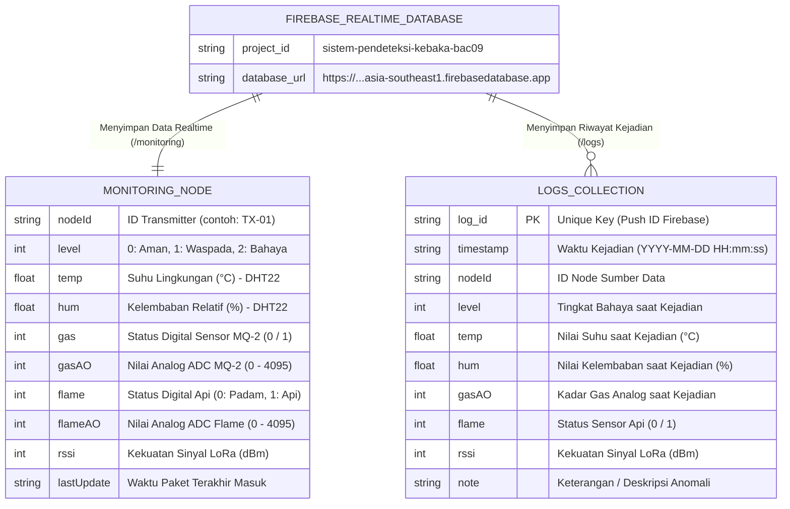
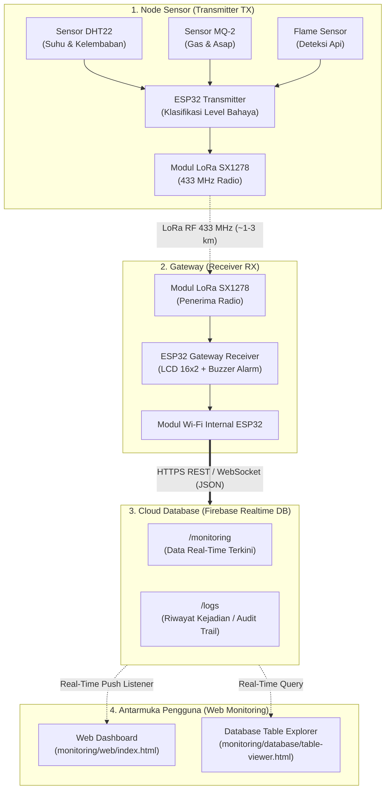

# 📊 Dokumentasi & Diagram Database — FireGuard LoRa

Dokumen ini memuat **Diagram Skema Database (ERD / NoSQL Schema)** dan **Kamus Data (Data Dictionary)** untuk sistem pendeteksi kebakaran berbasis LoRa IoT pada mata kuliah Wireless & Mobile Computing (WMC).

---

## 1. Diagram Skema Database (Entity-Relationship / Schema Diagram)

---

## 2. Diagram Alur Data Sistem (Data Flow Architecture)

---

## 3. Kamus Data (Data Dictionary)

### A. Tabel Node Real-Time: `/monitoring`
Tabel ini bertindak sebagai *single-record live state*. Nilai di dalamnya **di-overwrite setiap detik** oleh Gateway ESP32 RX saat menerima data telemetri baru dari Node TX.

| Nama Atribut | Tipe Data | Rentang / Satuan | Sumber Sensor | Keterangan |
| :--- | :--- | :--- | :--- | :--- |
| `nodeId` | String | misal: "TX-01" | Konfigurasi TX | Identitas unik perangkat sensor di lapangan |
| `level` | Integer | `0`, `1`, atau `2` | Algoritma ESP32 | Tingkat bahaya: `0` = Aman, `1` = Waspada, `2` = Bahaya |
| `temp` | Float | 0.0 – 100.0 (°C) | DHT22 | Suhu lingkungan di sekitar node |
| `hum` | Float | 0.0 – 100.0 (% RH) | DHT22 | Kelembaban relatif udara |
| `gas` | Integer | `0` (Low) atau `1` (High) | MQ-2 Digital | Status ambang batas digital komparator MQ-2 |
| `gasAO` | Integer | 0 – 4095 (ADC 12-bit) | MQ-2 Analog | Konsentrasi partikel asap & gas mudah terbakar |
| `flame` | Integer | `0` (Padam) atau `1` (Ada Api) | Flame Digital | Deteksi radiasi inframerah dari nyala api |
| `flameAO` | Integer | 0 – 4095 (ADC 12-bit) | Flame Analog | Intensitas radiasi nyala api (makin kecil makin dekat api) |
| `rssi` | Integer | -120 s/d -30 (dBm) | SX1278 Register | Indikator kekuatan sinyal transmisi gelombang LoRa |
| `lastUpdate`| String | Format Waktu | Internal RTC/Timer | Waktu terakhir kali gateway menerima paket dari TX |

---

### B. Tabel Riwayat Kejadian: `/logs`
Tabel ini bertindak sebagai *time-series audit trail*. Setiap kali terjadi peningkatan status bahaya (`level >= 1` atau `flame == 1`), sistem akan **menambahkan (append/push)** satu baris rekaman baru yang tersimpan permanen.

| Nama Atribut | Tipe Data | Format / Contoh | Keterangan |
| :--- | :--- | :--- | :--- |
| `log_id` | String (Key) | `-Nx9aBcDe123...` | Primary Key unik yang dihasilkan otomatis oleh Firebase |
| `timestamp` | String | `2026-11-13 16:50:12` | Tanggal dan jam kejadian saat anomali terdeteksi |
| `nodeId` | String | `TX-01` | Identitas node yang memicu anomali |
| `level` | Integer | `1` atau `2` | Status bahaya saat kejadian direkam |
| `temp` | Float | `58.2` | Nilai suhu puncak saat kejadian |
| `hum` | Float | `34.0` | Nilai kelembaban udara saat kejadian |
| `gasAO` | Integer | `850` | Nilai kadar gas MQ-2 saat kejadian |
| `flame` | Integer | `1` | Status sensor api saat kejadian |
| `rssi` | Integer | `-78` | Kualitas sinyal radio LoRa saat kejadian |
| `note` | String | `Bahaya: Api terdeteksi!` | Pesan ringkas penjelasan insiden |

---

## 4. Keunggulan Arsitektur Database Ini untuk Laporan Akademik

1. **Efisiensi Bandwidth & Penyimpanan**:
   - Memisahkan antara data live (`/monitoring`) dan data historis (`/logs`) mencegah database membengkak karena data kondisi normal tidak perlu disimpan ribuan kali per hari.
2. **Real-Time Subscription (WebSockets)**:
   - Web browser tidak perlu melakukan polling (menembak server berulang-ulang), melainkan Firebase yang aktif mendorong perubahan (*push notification*) dalam hitungan milidetik.
3. **Auditability (Pelaporan UAS/UTS)**:
   - Data pada node `/logs` dapat diekspor langsung ke format CSV/Excel melalui fitur yang sudah terpasang pada halaman Table Viewer.

